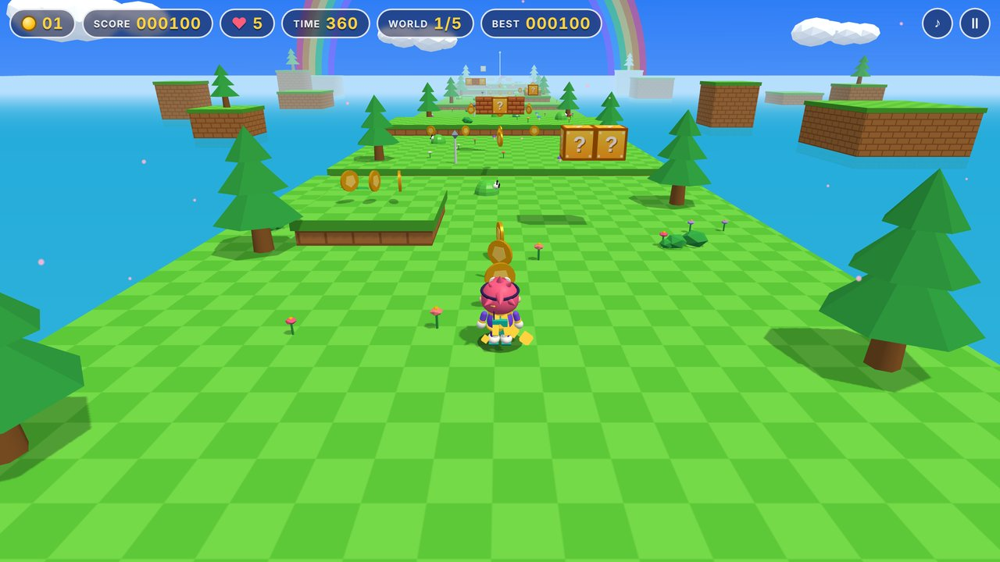
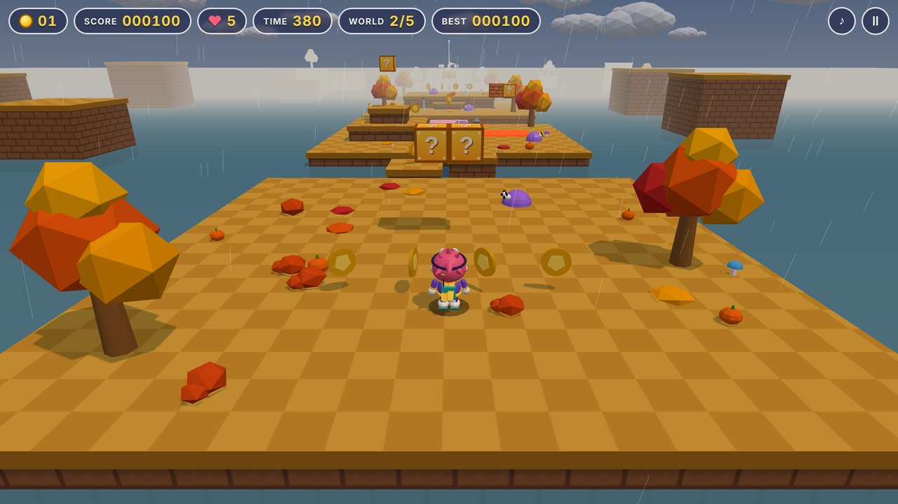
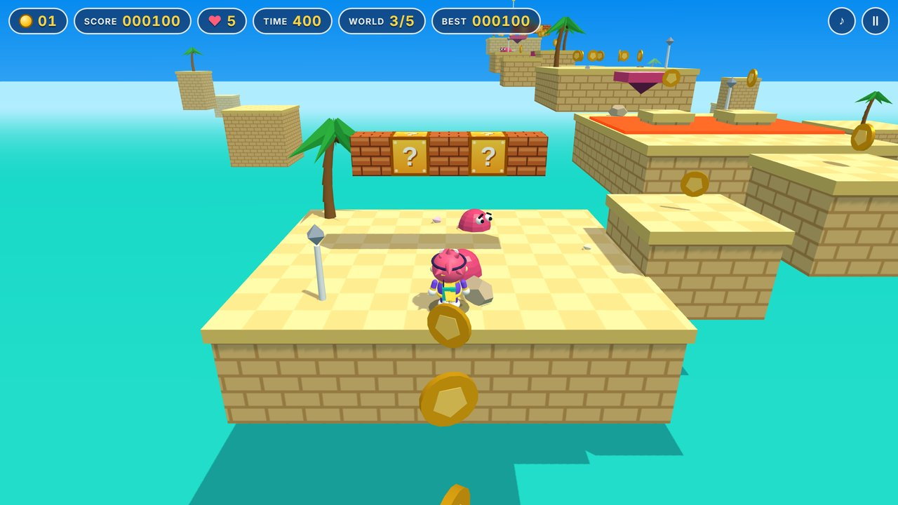
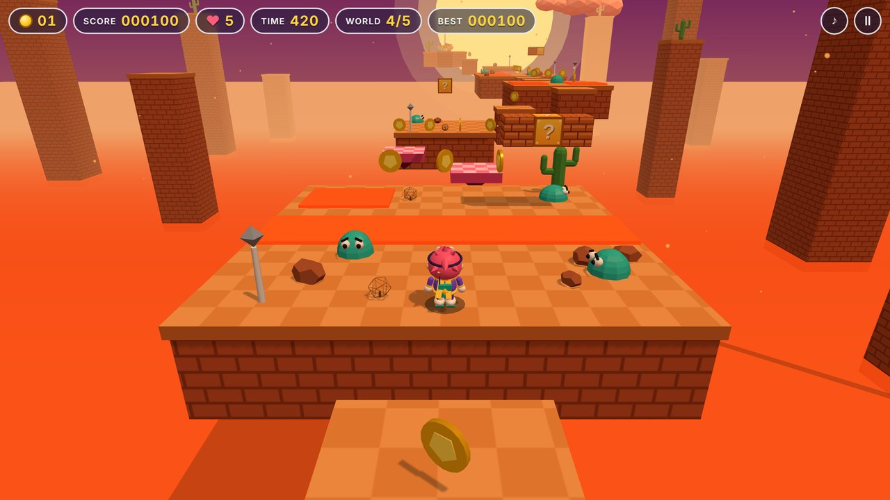
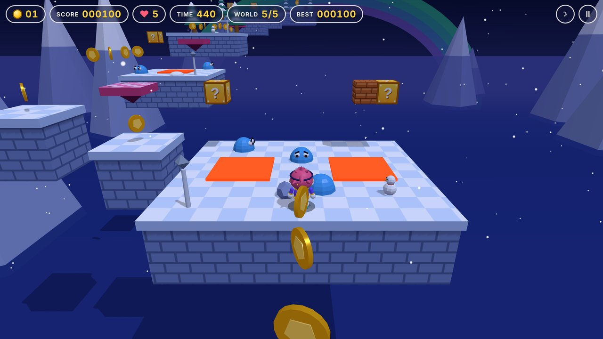

# Astra Dash

A responsive low-poly 3D platformer for the browser, built with [Three.js](https://threejs.org/) and [Vite](https://vite.dev/). All graphics are generated in code and all audio is synthesised live with the Web Audio API — there are no asset files.

## Play

| Action | Keyboard | Touch |
| --- | --- | --- |
| Move | `W` `A` `S` `D` / arrows | slide left thumb anywhere |
| Jump / double jump (hold for height) | `Space` | JUMP |
| Ground-pound (in mid-air) | `Shift` | SLAM |
| Turn camera | `Q` `E` or drag | follows you automatically; drag to adjust |
| Pause / mute | `P` / `M` | HUD buttons |

Cross five worlds that start on solid ground (with shallow rivers that only cost a splash) and build up to floating-island courses, hit `?` blocks from below (or pound them from above) for coins and Super Jump / Turbo Dash power-ups, which hop down to the ground beside the block, stomp slimes, avoid lava, and reach the flagpole before the timer runs out. 100 coins earn an extra life; the best score is kept in `localStorage`.

Every world has its own season and weather: a spring valley with drifting blossom, rainy autumn hills, sandy tropical isles, a desert mesa at dusk with embers, and a snowy summit at night under an aurora.

Jumping is assisted: while airborne a ring and drop line mark where you will land, the camera rises for a clearer view of the gap, you can steer and brake in mid-air, and narrowly clipping the edge of a ledge lifts you onto it.

Each world opens with a short story card: Astra the star-scout is recovering the five Star Sparks shaken out of the Comet's engine, one per world.

## Worlds

| | |
| --- | --- |
|  1. Green Valley |  2. Riverbend Hills |
|  3. Sunny Isles |  4. Sunset Mesa |
|  5. Starlight Summit | |

## Develop

```bash
npm install
npm run dev      # local dev server
npm run build    # production build into dist/
npm run preview  # serve the production build
```

## Project layout

```
index.html            HUD, menus and touch overlay
src/main.js           UI wiring and bootstrap
src/game.js           game loop, physics, camera, entities
src/levels.js         level and theme definitions
src/models.js         procedural meshes and textures
src/audio.js          Web Audio synthesiser (music + effects)
src/input.js          keyboard and touch input
public/                logo, favicon and app icons
scripts/prune-deployments.mjs   keeps only the newest Vercel deployment
```

## Deployment

Pushes to `main` run `.github/workflows/deploy.yml`, which builds and publishes a **production** deployment to Vercel and then deletes all older deployments. Vercel's own Git integration is disabled in `vercel.json`, so no preview deployments are created. The workflow needs `VERCEL_TOKEN`, `VERCEL_ORG_ID` (or `VERCEL_TEAM_ID`) and `VERCEL_PROJECT_ID` as repository secrets or variables.
